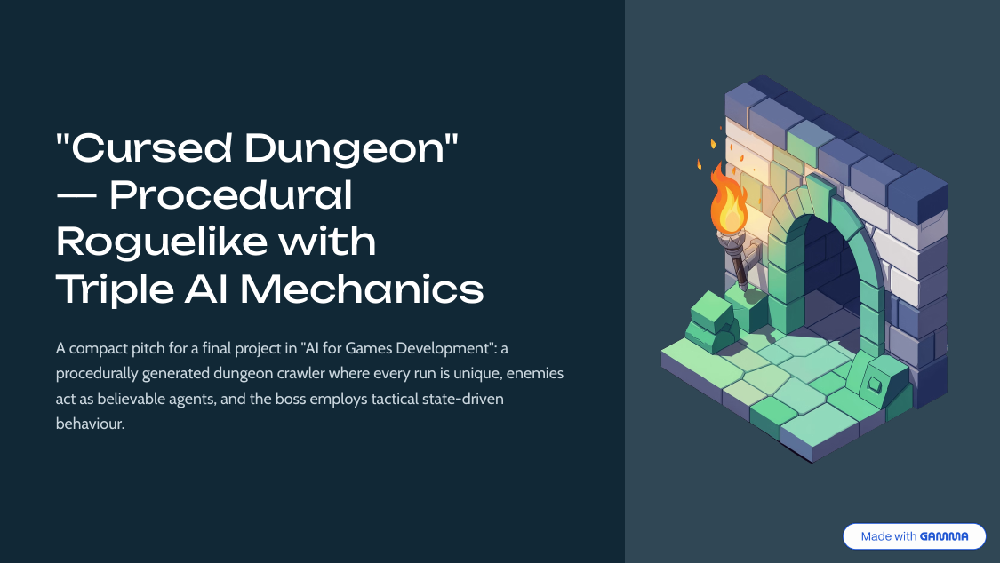

# Cursed Dungeon

A 2D procedural roguelike built in **Unity (C#)** for an *AI for Game Development* course. A lone knight descends into a cursed dungeon, fights waves of skeletons, defeats an orc boss, and reaches the exit — and every run is a different, procedurally generated level. The project showcases **three distinct game-AI techniques**, each written from scratch.



## The three AI mechanics

### 1. Cellular-automata level generation

Each level is a cave system grown with a cellular automaton (`LevelGenerator.cs`):

1. **Seed** every interior tile randomly as wall or floor (the border is always wall).
2. **Smooth** over 5 passes — each tile becomes wall or floor based on the majority of its neighbours, which turns noise into organic cave shapes.
3. **Keep the largest connected floor region** (found with a BFS flood fill) and wall off the rest, so the level is always fully traversable.
4. **Place the player, boss and exit maximally apart** using BFS distance from the player, forcing exploration, and scatter skeleton spawns away from the player with a bonfire near the boss.

The result is a new, fully-connected dungeon every run, with natural chokepoints for combat.

### 2. Steering behaviours for the skeletons

Skeletons (`SkeletonAI.cs`) move by blending three weighted steering forces each frame, with no per-agent pathfinding:

- **Pursue** — head toward the player when within detection range.
- **Separation** — push away from nearby skeletons to avoid clumping.
- **Cohesion** — a weak pull toward the local group centre.

Together these produce emergent group behaviour — the skeletons encircle and flank the player and move as a believable swarm rather than a single-file line.

### 3. A finite state machine for the orc boss

The boss (`OrcBossAI.cs`) is a four-state FSM with explicit transitions:

```
Patrol ──player in sight──▶ Chase ──in melee range──▶ Attack
  ▲                           │                          │
  └──────lost the player──────┘◀────player left range────┘

  any state, HP < 30% ──▶ Retreat ──heals at a bonfire, then──▶ Chase
```

- **Patrol** — walk between points in the room until it sees the player.
- **Chase** — pursue aggressively; switch to Attack in melee range, back to Patrol if the player escapes.
- **Attack** — perform attack combos; return to Chase when the player steps out of range.
- **Retreat** — below 30% HP, flee to the nearest bonfire, heal over time, then re-enter the fight at full health.

This makes the boss read the fight, punish reckless play, and force the player to adapt.

## Play

- **WASD** — move
- Attack key — melee nearby enemies
- Collect the objective, defeat the orc boss, and reach the exit. Watch your health — the dungeon is unforgiving.

## Run it

Requires **Unity** (opened with Unity Hub).

1. Open Unity Hub → Add → select this project folder.
2. Open the main scene under `Assets/_Root/Scenes`.
3. Press Play. Each run regenerates the level; set a fixed seed in the `LevelGenerator` inspector to reproduce one.

## Where the AI lives

```
Assets/_Root/Scripts/
  CoreAI/CellularAutomata/   LevelGenerator.cs, LevelPainter.cs   (mechanic 1)
  Enemies/SkeletonAI.cs                                           (mechanic 2)
  Enemies/OrcBossAI.cs                                            (mechanic 3)
  Enemies/                   spawners, death, contact damage, animation
  Player/                    movement, attack, camera, animation
  GameLoop/                  GameManager, ExitZone, menu
  Health/  UI/               health system and HUD
```

## Pitch deck

A short pitch deck describing the design is in [`docs/pitch-deck.pdf`](docs/pitch-deck.pdf).

## Credits

A team project for the *AI for Game Development* course. All AI logic — level generation, steering and the boss FSM — was written by the team; visual and audio assets are free third-party assets.

## License

[MIT](LICENSE)
